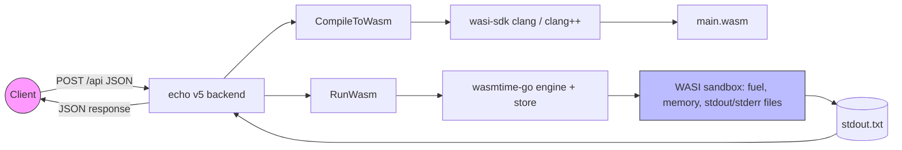

# LGTM - Looks Good To Monitor

*This project has been created as part of the 42 curriculum by tpandya & ohoro.*

## Overview

LGTM is a backend-first, sandboxed code-execution service written in Go. Users submit C or C++ source code over an HTTP API. The backend compiles the source to WebAssembly (WASM) using the WASI toolchain, executes the module in a Wasmtime sandbox with fuel, memory, and output limits, and returns the program output as JSON.

The project is part of the 42 Berlin "ft_lgtm" observability stack. The long-term target adds content-addressed source storage (IPFS), distributed tracing and metrics (OpenTelemetry), and Kubernetes (k3s) deployment — those are documented as future work and are not yet implemented.

## Architecture



| Stage | Implementation | Sandboxing |
|---|---|---|
| Compilation | `wasi-sdk` clang/clang++ → `wasm32-wasip1` | Temporary directory, process timeout |
| Execution | `wasmtime-go` instance of `_start` | Fuel metering, memory limiter, capped stdout |

## Feature status

| Component | Status |
|---|---|
| Go module + Echo v5 HTTP server | Implemented |
| `POST /api` JSON contract (code + language) | Implemented |
| C/C++ compile to WASM via wasi-sdk clang | Implemented |
| Wasmtime sandboxed execution | Implemented |
| Fuel limit, memory limit, output truncation | Implemented |
| viper configuration with env overrides | Implemented |
| HTTP health check `GET /health` | Implemented |
| Graceful shutdown | Implemented |
| Test suite (unit + contract + integration) | Implemented |
| CI pipeline (deps, lint, build) | Implemented |
| zap structured logging (factory present, no-op in main) | Implemented (not wired) |
| IPFS source storage (CID) | Not implemented |
| OpenTelemetry / Prometheus / Loki / Tempo / Grafana | Not implemented |
| k3s deployment on Ubuntu VM | Not implemented |

## Repository layout

```
ft_lgtm/
├── README.md                          # this file
├── config.yaml.example                # example configuration (config.yaml is gitignored)
├── go.mod / go.sum                    # Go module definition and locked dependencies
├── Makefile                           # build, run, test, lint, coverage targets
├── cmd/server/main.go                 # application entry point (Echo server, graceful shutdown)
├── internal/api/handler.go            # compile + execute pipeline, JSON contract
├── internal/api/handler_test.go       # unit, contract, and pipeline tests
├── internal/api/pipeline_test.go      # CompileToWasm / RunWasm integration tests
├── internal/api/dto.go                # ExecuteRequest / ExecuteResponse DTOs
├── internal/config/config.go          # viper configuration loader
├── internal/config/config_test.go     # configuration defaults and env override tests
├── internal/observability/logger.go   # zap logger factory (no-op in main today)
├── docs/                              # detailed documentation index (see docs/README.md)
├── scripts/bootstrap-lgtm-vm.sh       # Ubuntu VM bootstrap (Go, Podman, k3s)
├── docs/vm-setup.md                   # VirtualBox Ubuntu VM setup guide
└── .github/workflows/ci.yml           # GitHub Actions CI pipeline
```

## Quick start

### Prerequisites

- Go 1.27.2
- wasi-sdk 34 (clang / clang++ targeting `wasm32-wasip1`) installed at `~/wasi-sdk` or referenced via `WASI_SDK_PATH`

On macOS, download the wasi-sdk release tarball from the official repository and extract it to `~/wasi-sdk` (or set `WASI_SDK_PATH` to the extraction directory). Apple clang cannot target WASI because it lacks the WASI sysroot.

### Configure

Copy the example configuration:

```bash
cp config.yaml.example config.yaml
```

The config uses `viper` with env prefix `LGTM`. For example:

```bash
export LGTM_WASM_OUTPUT_LIMIT_KB=1
export LGTM_WASM_FUEL_LIMIT=1000
```

### Build and run

```bash
make build          # builds ./bin/lgtm-backend
./bin/lgtm-backend  # listens on :1222
# or
make run            # go run ./cmd/server/main.go
```

### Test the API

```bash
# valid C program
curl -sS -X POST http://127.0.0.1:1222/api \
  -H 'Content-Type: application/json' \
  -d '{"code":"#include <stdio.h>\nint main(void){ printf(\"hi\\n\"); return 0; }","language":"c"}'

# valid C++ program
curl -sS -X POST http://127.0.0.1:1222/api \
  -H 'Content-Type: application/json' \
  -d '{"code":"#include <iostream>\nint main(){ std::cout << \"hi\\n\"; return 0; }","language":"cpp"}'

# health check
curl -sS http://127.0.0.1:1222/health
```

### Testing

```bash
make test          # go test ./... -count=1
make test-short    # go test ./... -short -count=1 (skips wasi-sdk subprocess tests)
make coverage      # coverage report via go tool cover
```

Pipeline tests require wasi-sdk and skip automatically when it is absent.

## Documentation index

See `docs/README.md` for the full documentation index and reading paths.

## Roadmap (not implemented)

- Content-addressed source storage with IPFS and CID-based retrieval
- OpenTelemetry instrumentation, metrics, logs, and traces
- Kubernetes deployment with k3s on the Ubuntu VM
- Frontend integration (partner-owned)

## CI

[](https://github.com/tpandya42/ft_lgtm/actions/workflows/ci.yml)

CI runs dependency checks, format/lint, and build. Tests are not yet wired into CI.

---

*Backend-first implementation. Frontend and observability stack are handled separately within the project scope.*
