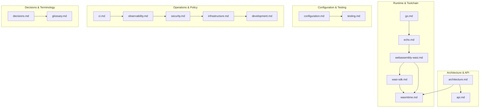

# Documentation index

This folder contains detailed, production-grade notes on every technology and design decision in the codebase. Documents are organized from architectural overview down to implementation details.

## Document map

## Reading paths

| Goal | Order |
|---|---|
| Understand the system | README.md → docs/architecture.md → docs/api.md |
| Run and develop locally | docs/development.md → docs/infrastructure.md → docs/testing.md |
| Debug a failing compile/run | docs/wasi-sdk.md → docs/wasmtime.md → docs/testing.md |
| Extend or change configuration | docs/configuration.md |
| Review design decisions | docs/decisions.md |
| Learn terms used in code and docs | docs/glossary.md |

## Documents

| Document | Covers | Level |
|---|---|---|
| architecture.md | System context, components, request lifecycle, failure modes | Architectural |
| api.md | POST /api, GET /health, schemas, status codes, curl examples | Reference |
| configuration.md | viper loader, precedence, env overrides, full key table | Reference |
| go.md | Go module/package layout, idioms, toolchain | Tutorial/reference |
| echo.md | Echo v5 routing, binding, middleware, graceful shutdown | Tutorial/reference |
| webassembly-wasi.md | WASM module model, WASI, wasm32-wasip1, sandboxing | Tutorial |
| wasi-sdk.md | Toolchain contents, flags, compiler resolution, temp dirs | Reference/troubleshooting |
| wasmtime.md | Engine/Store/Module/Linker/Instance, fuel, memory, traps | Reference |
| testing.md | Unit/contract/integration layers, skip logic, commands | Tutorial |
| ci.md | GitHub Actions jobs, lint/format gates, known gaps | Reference |
| observability.md | zap logger factory, Echo request logger | Reference |
| security.md | Threat model, sandbox controls, residual risks | Architectural |
| infrastructure.md | VM setup, bootstrap script, current vs target deployment | Architectural |
| development.md | Local setup, Make targets, debugging, common errors | Tutorial |
| decisions.md | ADRs for all major technical choices | Architectural |
| glossary.md | WASM/WASI/CID/OTel/LGTM terminology | Reference |

## Related files outside docs/

- `config.yaml.example` — tracked example configuration (see `docs/configuration.md`)
- `scripts/bootstrap-lgtm-vm.sh` — VM bootstrap (see `docs/infrastructure.md`)
- `docs/vm-setup.md` — VirtualBox Ubuntu VM setup guide (kept separately)
