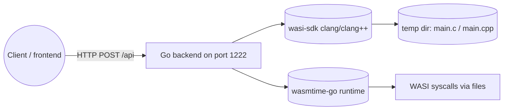
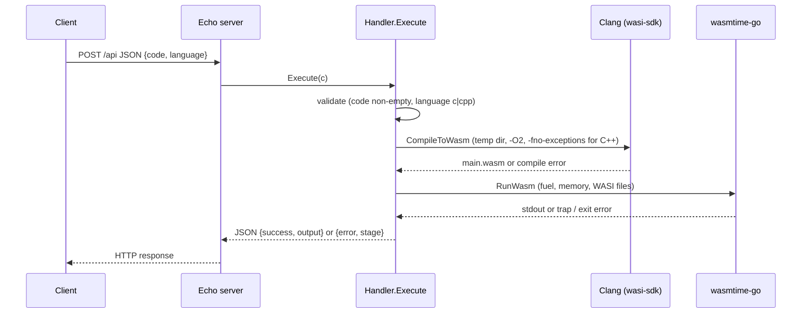

# Architecture

LGTM is a small, single-service Go application that accepts source code over HTTP, compiles it to WebAssembly (WASM), executes it inside a Wasmtime sandbox, and returns the output as JSON.

## System context

## Components

| Component | Path | Responsibility |
|---|---|---|
| Entry point | `cmd/server/main.go` | Config load, Echo bootstrap, graceful shutdown via `net/http.Server` |
| Handler | `internal/api/handler.go` | JSON contract, compile pipeline, execute pipeline |
| DTOs | `internal/api/dto.go` | `ExecuteRequest`, `ExecuteResponse` |
| Configuration | `internal/config/config.go` | viper loader with env prefix `LGTM` |
| Logging | `internal/observability/logger.go` | zap factory (not wired into main yet; main uses `zap.NewNop()`) |

## Request lifecycle

## Failure modes and status codes

| Failure | Status | `stage` field |
|---|---|---|
| Malformed JSON | 400 | empty |
| Empty `code` | 400 | empty |
| Unsupported `language` | 400 | empty |
| Compilation failure / timeout | 422 | `compilation` |
| Execution trap / non-zero exit | 422 | `execution` |
| Internal error (temp dir, file I/O) | 500 | empty |

Sentinel errors (`ErrCompilationFailed`, `ErrCompilationTimeout`, `ErrExecutionFailed`, `ErrUnsupportedLanguage`) are wrapped with `%w` so the HTTP layer classifies them with `errors.Is` rather than string matching.

## Current vs target topology

Today the backend runs as a single binary on the developer machine (`localhost:1222`). The target topology (not yet implemented) deploys it into k3s on the Ubuntu VM behind an ingress with domain `lgtm.local`, and adds IPFS storage and the observability stack. Those components are intentionally absent from this document until implemented.
