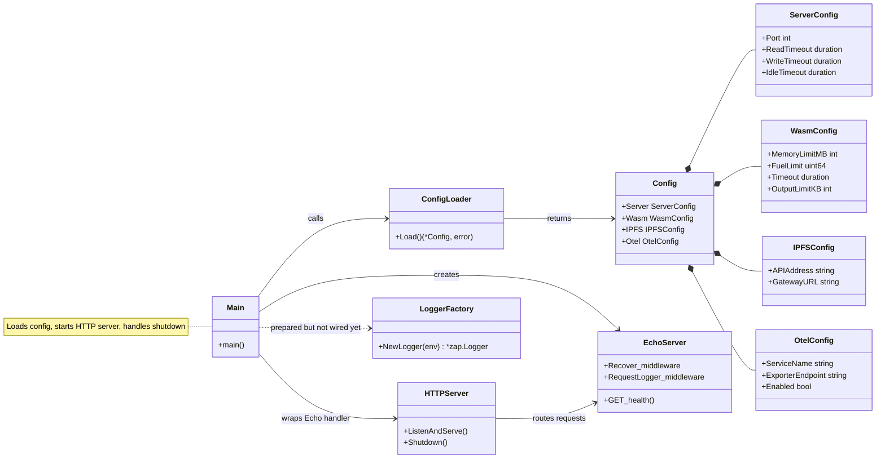

# Architecture

This document describes the current backend architecture. The project is still
in an early stage, so the diagram should be read as a snapshot of the foundation
we have today, not as the final LGTM system.

## Current Backend Structure

## Current State

The repository currently contains a small Go backend skeleton. It loads
configuration, creates an Echo server, exposes a basic health route, and wraps
the router in an explicit `net/http.Server` so the application can control
timeouts and shutdown behavior.

The larger project direction is already visible in the configuration model:
WASM execution, IPFS sharing, and OpenTelemetry are represented as configuration
sections. The runtime implementations for those parts do not exist yet. Keeping
them in the config at this stage makes the intended boundaries visible while the
actual features are still being designed.

## Design Rationale

`main.go` currently acts as the composition root. It is responsible for loading
configuration, creating the HTTP stack, registering middleware and routes, and
handling graceful shutdown. This keeps startup behavior easy to understand while
the project is still small.

The tradeoff is that `main.go` should not become the long-term home for every
future feature. Once WASM execution, IPFS upload, and OpenTelemetry wiring become
real behavior, those responsibilities should move into focused packages.

Configuration is centralized in `internal/config` and loaded with Viper. Defaults
make the backend runnable without a local config file, while environment
variables and YAML configuration leave room for local VM usage and later
Kubernetes deployment. The tradeoff is flexibility versus strictness: validation
will become more important once the configured components are required at
runtime.

Echo gives the backend a compact routing and middleware layer. At the same time,
the code still creates a standard `net/http.Server` explicitly, which keeps
production-relevant controls such as read, write, idle timeouts, and graceful
shutdown close to the entry point.

The logger factory under `internal/observability` is prepared but not fully wired
yet. This shows the intended observability direction without forcing the final
logging setup too early. The immediate tradeoff is that request logging currently
uses a no-op logger and therefore stays silent.

## Library Choices

- **Viper** is a good fit at this stage because the project will likely need
  multiple configuration sources: local YAML files for development, environment
  variables for containers, and sensible defaults for quick startup. A smaller
  hand-written loader would be simpler today, but it would probably need to be
  expanded once the VM and Kubernetes setup become part of the normal workflow.

- **Echo** is a pragmatic routing choice. The Go standard library would be
  enough for the current health route, but Echo provides middleware, request
  handling, and routing patterns that will become useful once the API grows. The
  tradeoff is accepting a framework dependency before the application strictly
  needs one.

- **Zap** was chosen for structured logging with low runtime overhead. That
  matters for an observability-focused project, because logs should eventually
  correlate with traces and metrics instead of being plain text only. The current
  implementation keeps the logging surface small until the OpenTelemetry setup is
  introduced.

## Evolution

This document should evolve with the repository. The current structure favors
clarity over abstraction. New packages should be introduced when real behavior
appears, not before. Expected future additions include a WASM runner, an IPFS
client, OpenTelemetry instrumentation, frontend integration, and Kubernetes
deployment manifests.
