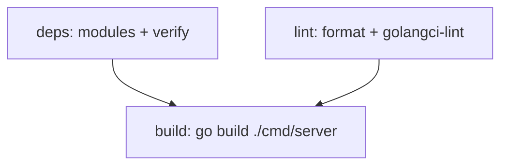

# CI

The GitHub Actions workflow (`.github/workflows/ci.yml`) runs on push to `main` and on pull requests.

## Jobs

| Job | Steps | Purpose |
|---|---|---|
| `deps` | checkout, setup-go, `go mod tidy` + `git diff`, `go mod verify` | Ensures `go.mod`/`go.sum` are committed in sync |
| `lint` | checkout, setup-go, `gofmt -l .`, golangci-lint | Formatting and static lint gates |
| `build` | checkout, setup-go, `go build -o /dev/null ./cmd/server` | Compiles the backend (depends on deps, lint) |

## Format gate

The `lint` job fails if `gofmt -l .` lists any files. Locally: `gofmt -w .`.

## Known gaps

- **No test job yet.** `make test` / `go test ./...` runs locally but is not executed in CI. Pipeline tests skip without wasi-sdk, so a `-short` run is safe on standard runners.
- The PR template (`docs`/`checklist`) requires tests and documentation updates, but CI does not enforce them.

## Pull requests

The repository uses `.github/pull_request_template.md`, which requires a description, change list, testing steps, and checklist. CI status must be green before merge.
