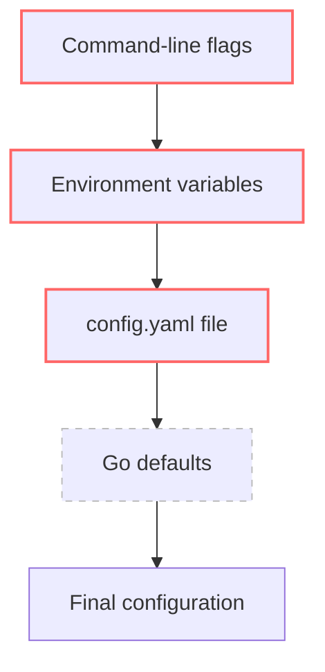

# Configuration

Configuration is loaded by `internal/config/config.go` using **viper**. The loader supports three sources in precedence order:

Note: command-line flag parsing is declared as a future step in the source comment but is not yet implemented. Current effective precedence: **env > file > defaults**.

## viper setup

| Setting | Value |
|---|---|
| Config name | `config` |
| Config type | `yaml` |
| Config paths | `.`, `./config` |
| Env prefix | `LGTM` |
| Env key replacer | `.` → `_` |
| Auto env | enabled |

Because of the replacer, `wasm.fuel_limit` maps to env var `LGTM_WASM_FUEL_LIMIT`.

## Complete key reference

| Section | Key | Type | Default | Env override | Status |
|---|---|---|---|---|---|
| server | `server.port` | int | `1222` | `LGTM_SERVER_PORT` | Used |
| server | `server.read_timeout` | duration | `10s` | `LGTM_SERVER_READ_TIMEOUT` | Used |
| server | `server.write_timeout` | duration | `30s` | `LGTM_SERVER_WRITE_TIMEOUT` | Used |
| server | `server.idle_timeout` | duration | `60s` | `LGTM_SERVER_IDLE_TIMEOUT` | Used |
| wasm | `wasm.memory_limit_mb` | int | `10` | `LGTM_WASM_MEMORY_LIMIT_MB` | Used |
| wasm | `wasm.fuel_limit` | uint64 | `5000000` | `LGTM_WASM_FUEL_LIMIT` | Used |
| wasm | `wasm.timeout` | duration | `5s` | `LGTM_WASM_TIMEOUT` | Loaded, unused |
| wasm | `wasm.output_limit_kb` | int | `10` | `LGTM_WASM_OUTPUT_LIMIT_KB` | Used |
| wasm | `wasm.compile_timeout` | duration | `15s` | `LGTM_WASM_COMPILE_TIMEOUT` | Used |
| ipfs | `ipfs.api_address` | string | `/ip4/127.0.0.1/tcp/5001` | `LGTM_IPFS_API_ADDRESS` | Reserved |
| ipfs | `ipfs.gateway_url` | string | `http://ipfs.lgtm.local` | `LGTM_IPFS_GATEWAY_URL` | Reserved |
| otel | `otel.service_name` | string | `lgtm-backend` | `LGTM_OTEL_SERVICE_NAME` | Reserved |
| otel | `otel.exporter_endpoint` | string | `http://otel-collector:4317` | `LGTM_OTEL_EXPORTER_ENDPOINT` | Reserved |
| otel | `otel.enabled` | bool | `false` | `LGTM_OTEL_ENABLED` | Reserved |

## Notes

- `config.yaml` is gitignored; `config.yaml.example` is the committed template.
- Missing config file is tolerated (`ConfigFileNotFoundError` is ignored); defaults and env vars still apply.
- Durations are parsed by viper's mapstructure duration hook (e.g. `15s`, `1ms`).
- `wasm.timeout` is loaded but not consumed by `RunWasm` today; execution is limited by fuel metering only.
- IPFS and OTel sections exist as reserved placeholders for future work; no code reads them yet.
