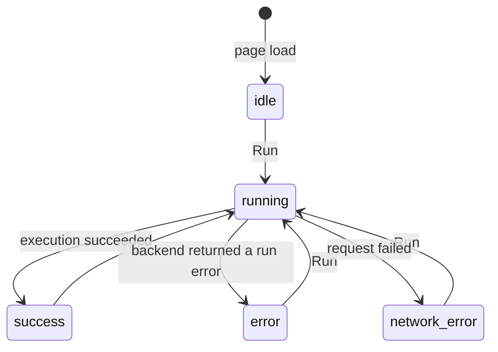

# Frontend State Flow

This note defines the first state model for the LGTM playground frontend. The
goal is to keep the first implementation small: one editor, one run button, and
one result panel.

This is a first proposal, not a fixed contract. We can adjust the states and API
shape once the backend behavior becomes clearer during implementation.

The basic rule is:

- the editor contains the current code
- the result panel shows the last execution
- editing code does not clear the last result

That keeps the UI predictable. A user can change code while still seeing what
the previous run produced.

## Statechart



## States

`idle` means the page is loaded and the default example is visible in the
editor. No code has been executed yet.

`running` means the frontend has submitted the current editor content to the
backend and is waiting for a response. The run button should be disabled in this
state.

`success` means the backend compiled and executed the code, uploaded the result
to IPFS, and returned output data to the frontend.

`error` means the backend answered, but the run did not complete successfully.
This can be a compilation error, execution error, timeout, output limit error, or
IPFS upload error.

`network_error` means the frontend could not get a usable response from the
backend. This is separate from `error` because it points to the platform or local
setup, not to the submitted code.

## Data Model

The frontend only needs a small amount of state.

```txt
code         current editor content
status       idle | running | success | error | network_error
result       output from the last successful execution
error        last backend or network error
lastRunCode  code that produced the currently displayed result
```

`lastRunCode` is useful because the UI can derive whether the editor has changed
since the last run:

```txt
isDirty = code != lastRunCode
```

This does not need to be a separate state. It is just a hint the UI can show
later, for example as "Code changed since last run".

## Run Flow

When the user clicks `Run`, the frontend reads the current editor content and
sends it to the backend.

```txt
Run clicked
-> read editor content
-> status = running
-> POST /api/run
-> wait for response
```

On success:

```txt
-> status = success
-> result = response body
-> lastRunCode = submitted code
-> error = null
```

On a backend run error:

```txt
-> status = error
-> error = response body
```

On a failed request or invalid response:

```txt
-> status = network_error
-> error = local request error
```

## Suggested API Shape

The frontend should only depend on a small JSON contract.

Request:

```json
{
  "code": "..."
}
```

Successful response:

```json
{
  "stdout": "Hello LGTM\n",
  "stderr": "",
  "cid": "bafy...",
  "ipfs_url": "http://ipfs.lgtm.local/ipfs/bafy...",
  "duration_ms": 42
}
```

Error response:

```json
{
  "error": "Compilation failed",
  "phase": "compile",
  "details": "expected `;` at line 3"
}
```

The `phase` field should stay small and explicit. Good starting values are
`compile`, `execute`, `ipfs`, and `unknown`.

## Why This Shape

This model is small enough to implement with plain JavaScript. It does not need a
frontend framework or global state library.

It also separates two concerns that are easy to mix up:

- editing code
- executing a submitted version of that code

That separation makes the UI easier to reason about. The editor may change at
any time, while the result panel keeps showing the last completed run.

The split between `error` and `network_error` is also intentional. A syntax error
in the submitted code should not look like a broken backend. A missing backend
should not look like a failed compilation.

This state model should continue to work if the first textarea editor is later
replaced with CodeMirror.
