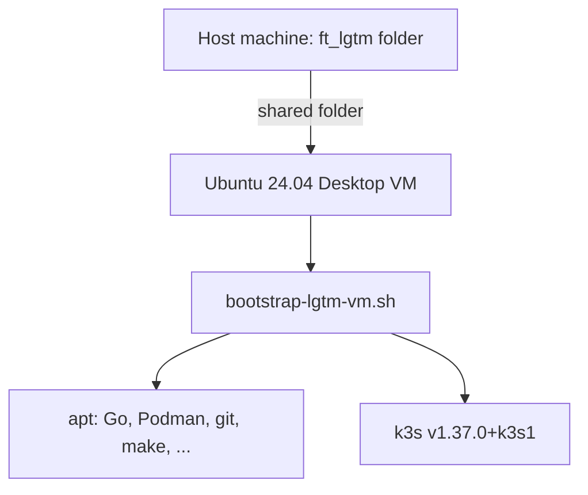

# Infrastructure

## Local development

The backend runs directly on the developer machine:

```text
Developer machine
├── Go 1.27.2
├── wasi-sdk 34 (~/wasi-sdk or WASI_SDK_PATH)
└── bin/lgtm-backend  → listens on :1222
```

## Ubuntu VM (existing)

The repository includes `docs/vm-setup.md`, a guide for installing Ubuntu 24.04 LTS Desktop in VirtualBox with shared folders pointing to the host project directory (`/media/ft_lgtm`).

## Bootstrap script

`scripts/bootstrap-lgtm-vm.sh` installs, inside a fresh Ubuntu VM:

- SSH, git, make, curl, rsync
- Go (`golang-go`)
- Podman (`podman`, `uidmap`, `slirp4netns`)
- k3s (`K3S_VERSION=v1.37.0+k3s1`, optional via `INSTALL_K3S`)



## Current deployment state

The backend is **not yet deployed** to the VM or to k3s. Podman and k3s are installed by the bootstrap script but unused by the Go code. The target deployment is k3s on the VM behind an ingress with domain `lgtm.local` — documented as future work only.
