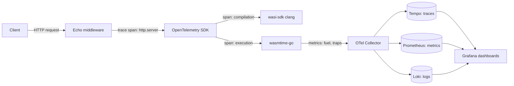

# Observability (current state)

## Implemented today

The only observability code in the codebase is structured logging via **zap** (`go.uber.org/zap`):

- `internal/observability/logger.go` — `NewLogger(env string)` returns a production or development zap config:
  - `production` → `zap.NewProductionConfig()` with ISO8601 timestamps.
  - anything else → `zap.NewDevelopmentConfig()` with colored capital level encoding.
- `cmd/server/main.go` — currently instantiates `zap.NewNop()` (disabled) until the logger is wired.
- Echo `RequestLoggerWithConfig` middleware logs method, URI, status, and latency per request through the (currently no-op) logger.

## Not implemented yet

OpenTelemetry instrumentation (traces, metrics), Prometheus, Loki, Tempo, and Grafana are part of the project's long-term observability goal (the "LGTM" stack). Config keys exist as reserved placeholders:

- `otel.service_name` (`lgtm-backend`)
- `otel.exporter_endpoint` (`http://otel-collector:4317`)
- `otel.enabled` (`false`)

None of these keys are read by `main.go` or `handler.go` today.

## Future direction (planned, not implemented)

When wired, observability should span every pipeline stage:

This diagram describes the intended end state and does not reflect implemented code.
