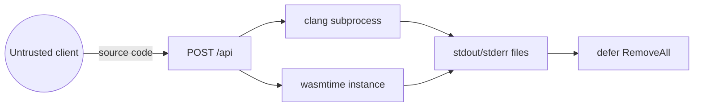

# Security

## Threat model

The backend accepts and executes **untrusted user-supplied C/C++ source code**. The primary risks are:

1. Malicious or buggy code exhausting CPU or memory.
2. Code escaping the sandbox and accessing the host filesystem or network.
3. Denial of service via compile-time resource exhaustion.
4. Information leakage through error messages.

## Sandbox controls

| Control | Implementation | What it prevents |
|---|---|---|
| WASI capability sandbox | wasmtime instance with host-provided file descriptors only | Arbitrary filesystem / network access |
| Fuel metering | `store.SetFuel(fuel_limit)` | Infinite loops / CPU exhaustion |
| Memory limiter | `store.Limiter(memoryBytes, ...)` | Memory growth beyond `wasm.memory_limit_mb` |
| Output cap | Truncation after `OutputLimitKB` | Unbounded stdout generation |
| Compile timeout | `context.WithTimeout(compile_timeout)` | Clang running indefinitely |
| Temp directory isolation | `os.MkdirTemp` + `defer os.RemoveAll` | Source/WASM artifacts left on disk |
| Input validation | Empty-code and language checks before compile | Malformed requests reaching the compiler |
| Language allowlist | `c` or `cpp` only | Unexpected compiler invocations |

## Attack surface

## Residual risks (known gaps)

| Risk | Status | Mitigation planned |
|---|---|---|
| No wall-clock execution timeout | Present | Wire `wasm.timeout` into `RunWasm` |
| No code-size cap | Present | Reject oversized `code` before compile |
| Error text may leak temp paths | Present | Sanitize compiler/runtime errors before client response |
| Concurrent request resource exhaustion | Present | No rate limiting or request concurrency cap |
| `wasm.timeout` loaded but unused | Present | Implement execution deadline |

## Assumptions

- The service is not exposed to the public internet without additional network-layer controls (ingress, rate limiting, WAF).
- wasi-sdk and wasmtime are kept patched; no dependency-vulnerability scanning is in place yet.
