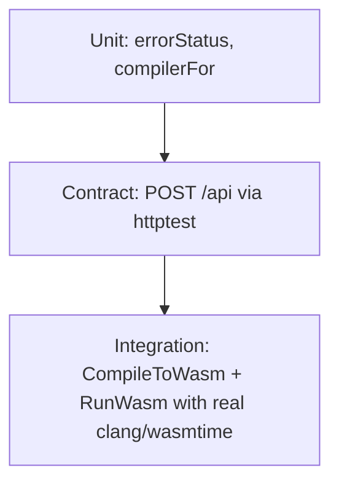

# Testing

## Test layers



| Layer | File | What it covers | Runs without wasi-sdk? |
|---|---|---|---|
| Unit | `handler_test.go` | `errorStatus` status mapping, `compilerFor` resolution | Yes |
| Contract | `handler_test.go` | `POST /api` validation: malformed JSON, empty body, missing code, unsupported language → 400 | Yes |
| Integration | `handler_test.go` (`TestExecutePipeline`) | Full pipeline: C/C++ execution, fuel trap, non-zero exit, output truncation | No — skips |
| Integration | `pipeline_test.go` | `CompileToWasm` language error, compile timeout, `RunWasm` exit codes | No — skips |
| Configuration | `config_test.go` | viper defaults, env override precedence | Yes |

## Helpers

- `newTestEcho(cfg)` — builds an `*echo.Echo` with `POST /api` wired to `Handler.Execute`.
- `postJSON(t, e, body)` — issues an in-memory `httptest` request with `Content-Type: application/json` via `e.ServeHTTP` (no real port).
- `requireWasiSDK(t)` — skips if `~/wasi-sdk` (or `WASI_SDK_PATH`) clang is absent.
- `requirePipeline(t)` — skips in `testing.Short()` mode and without wasi-sdk.

## Run/skip decision

```mermaid
flowchart TD
    Start[go test] --> Short{testing.Short()?}
    Short -->|Yes| SkipPipeline[skip pipeline tests]
    Short -->|No| SDK{wasi-sdk present?}
    SDK -->|No| SkipPipeline
    SDK -->|Yes| Run[run pipeline tests]
    Start --> RunUnit[unit + contract always run]
```

## Commands

```bash
make test          # go test ./... -count=1   (full suite)
make test-short    # go test ./... -short -count=1 (CI-safe without wasi-sdk)
make coverage      # coverage report

go test ./internal/api -v -count=1        # verbose API tests
go test ./internal/api -run TestExecutePipeline -v  # pipeline only
```

## Design notes

- All tests are table-driven where a case matrix exists.
- `json.Marshal` builds request bodies so multi-line C/C++ source never needs manual escaping.
- Assertions use `strings.Contains` for compiler/runtime output rather than exact strings, since clang/wasmtime messages vary by version.
- `t.Helper()` is used on all helpers so failures point at the test, not the helper.
- Pipeline tests run once (`-count=1`) to avoid test-cache masking of subprocess behavior.
