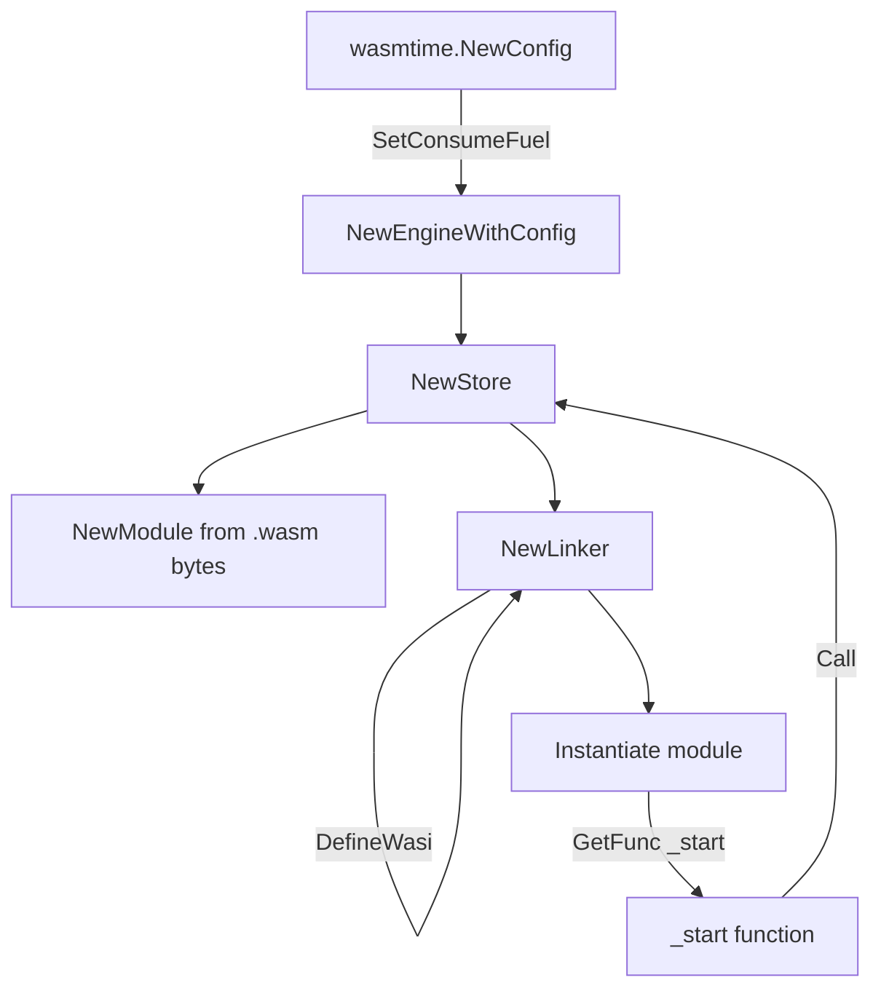

# wasmtime-go

The runtime is **wasmtime-go v49** (`github.com/bytecodealliance/wasmtime-go/v49`), Go bindings for the Wasmtime WebAssembly runtime.

## Object graph

## Sandbox controls

| Control | API | Default / value |
|---|---|---|
| Fuel | `store.SetFuel(uint64)` | `wasm.fuel_limit` (default 5,000,000) |
| Memory | `store.Limiter(memoryBytes, ...)` | `wasm.memory_limit_mb` × 1 MiB (default 10 MiB) |
| WASI args | `wasi.SetArgv(["program"])` | Fixed argv |
| WASI stdout | `wasi.SetStdoutFile(path)` | Temp `stdout.txt` |
| WASI stderr | `wasi.SetStderrFile(path)` | Temp `stderr.txt` |

## Trap vs clean exit

WebAssembly modules terminate via `proc_exit(code)`, which Wasmtime surfaces as a `*wasmtime.Error` carrying an exit status:

- `proc_exit(0)` → clean success; output is read from `stdout.txt`.
- `proc_exit(n != 0)` → error wrapped as `ErrExecutionFailed`.
- Fuel exhaustion → trap "all fuel consumed" → `ErrExecutionFailed`.
- Memory limit breach → growth failure → `malloc` returns NULL (observable program output).

## Output handling

1. Execute `_start`.
2. Read `stdout.txt` from the host filesystem.
3. Truncate to `OutputLimitKB` bytes if exceeded.
4. Return the string to the HTTP handler.

## Limitations today

- No wall-clock execution timeout; only fuel metering bounds CPU. A syscall-heavy or otherwise fuel-cheap loop could run long. See `docs/security.md`.
- `wasm.timeout` is loaded from config but not wired into `RunWasm`.
