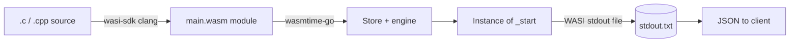

# WebAssembly + WASI

## What WebAssembly is

WebAssembly (WASM) is a portable, stack-based virtual instruction set. A WASM module consists of:

- **Imports** — functions and memory the module expects from the host.
- **Exports** — functions and memory the module exposes to the host.
- **Linear memory** — a growable, contiguous byte array shared between module and host.
- **Functions** — stack-machine bytecode operating on i32/i64/f32/f64 values.

## Why WASM here

The backend executes untrusted user-supplied C/C++ code. Compiling to WASM and running it in a Wasmtime sandbox provides capability-based isolation: the module cannot access the filesystem, network, or environment unless the host explicitly grants it through WASI.

## WASI

**WebAssembly System Interface** (WASI) is a modular system interface for WASM. The target used is `wasm32-wasip1`:

- Programs start at the exported `_start` function.
- Termination uses `proc_exit(code)`.
- File access, randomness, clocks, and environment are mediated by the host through WASI file descriptors.

In this project, WASI stdout and stderr are redirected to host-side temp files (`stdout.txt`, `stderr.txt`), which the backend reads after execution.

## Compile-time vs runtime

## Limits enforced at runtime

| Limit | Mechanism | Effect |
|---|---|---|
| CPU | Fuel metering (`store.SetFuel`) | Infinite loops trap with "all fuel consumed" |
| Memory | `store.Limiter` | Memory growth beyond the cap fails; `malloc` returns NULL |
| Output | Byte truncation after read | Stdout capped at `OutputLimitKB` |
| Compile time | `context.WithTimeout` | Clang subprocess killed after deadline |
